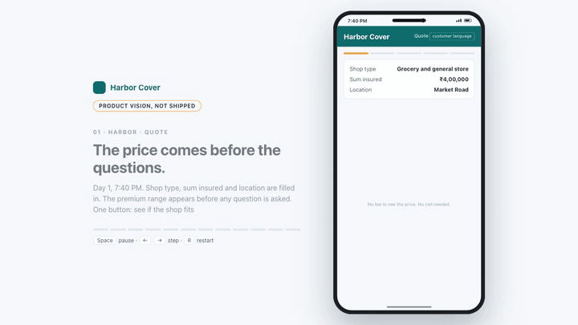
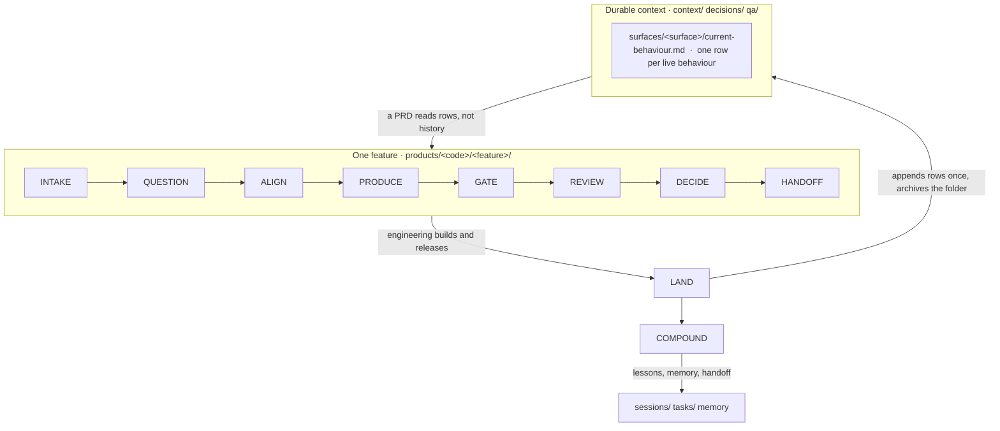
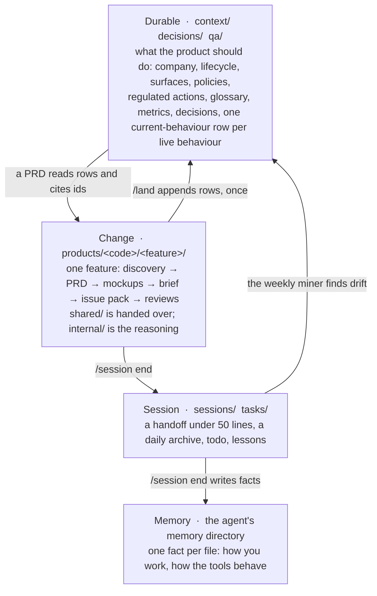
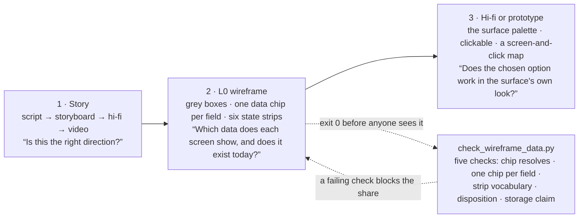

# Shipwright

A harness that runs product work as a system, not as a chat. Skills, read-only reviewers and hooks sit on
top of a durable context layer, and one fictional company runs through it end to end.


Clone this repository, run `claude`, then run `/onboard`. From then on, start every piece
of product work with `/product-loop`.

It is a template repo and a Claude Code plugin for product leads: a founder doing product
alone, or a product team at a company up to Series C, building for internal and external
users. Claude Code first; Codex reads the same layout.

## See it work



The worked feature, "verification outcome and rework", told as a story: the price before
the questions, one paper at a time, the officer naming the reason once. These are the first
three of twelve beats. The full story is
`products/desk/verification-outcome-and-rework/showcase/story-v1.html`. Product vision, not
shipped; every number on screen is a demo number.

## Start in sixty seconds

```bash
git clone https://github.com/DvJ4Y/shipwright shipwright && cd shipwright
claude            # accept the trust dialog on the first run
/onboard          # setup, your profile, the skills on the worked example, one real item
```

Then start any piece of work with `/product-loop`. It returns a verdict, a tier and the
skills to run.

**Or install the plugin into a project you already have:**

```
/plugin marketplace add DvJ4Y/shipwright
/plugin install shipwright@shipwright
```

Clone or plugin, never both in one repo: the plugin inside a clone runs every hook twice.
The plugin carries the skills, the reviewers and the hooks. The clone also carries the
context, the worked example, the tools and the automations. `docs/09-running-your-agent.md`
has the detail, including the Codex behaviours not yet verified.

## The loop



The loop ends at LAND, not at HANDOFF. When a feature ships, `/land` appends one row per
requirement to the surface's current-behaviour table and archives the feature folder. The
next PRD reads rows, not history. Every correction becomes a rule in `tasks/lessons.md`.

| You say | The harness does |
|---|---|
| "I want to work on…" | `/product-loop` — go, clarify or park; tier S, M or L; the workflow of skills |
| "Is this worth building?" | `/product-discovery` — labelled evidence, operational viability, a verdict |
| "Help me decide" | `/decide` — your leaning first, three rounds at most, a logged decision point |
| "Write the PRD" | `/prd-writer` — WHAT and WHY, observable acceptance, every state the screen can reach |
| "Mock this up" | `/mockup` — a story, a wireframe with a data chip on every field, hi-fi, prototype |
| "Write the copy" / "translate this" | `/product-copy`, `/localisation-copy` |
| "Review this" | `/review` — read-only lenses; Critical, Major, Minor, Outdated; one verdict |
| "Hand to engineering" | `/engineering-brief`, then `/issue-tracker` — pack, publish, read-back |
| "This shipped" | `/issue-tracker release`, `/review post-ship`, `/land` |
| "Pull the data" | `/data-analysis` — decision, boundary, source, label |

Underneath: always-on rules; three hooks that load your context at start, ask for a
handoff at stop and block edits to generated files; curated permissions; two MCP servers;
a weekly sync that checks the context against the week's sessions. Where judgement stays
human: every gate, every locked decision, talking to customers.

## Four context layers



Durable context is the source of truth; every artifact is regenerable from it. The product
lead reviews a small body of context and a short change, not every line of every document.
`docs/02-context-layers.md` says what goes where; `docs/00-why.md` says why.

## The visual method



Three steps, in order. Each answers a different question. None is a source of business
rules; the PRD is. The wireframe checker reads the feature's data packet and fails the
share when a chip points at nothing. `docs/04-visual-method.md` has the rules.

## The layout at a glance

```
AGENTS.md  CLAUDE.md  _profile.md      the agent's instructions and your profile
.agents/skills/  .agents/hooks/        16 skills and 3 hooks — the source of truth
.claude/  .codex/                      wrappers: rules, reviewers, settings
context/                               the durable layer: company, lifecycle, surfaces, policies, glossary, metrics
context/surfaces/<surface>/            what each surface does today, one row per behaviour
products/<code>/<feature>/             one feature: shared/ (handed over) · internal/ (reasoning) · mockups/ · showcase/
decisions/  qa/  releases/             the decision log · test-case catalogs · release notes
sessions/  tasks/                      handoffs · todo · lessons
tools/  automations/  templates/       wireframe kit, story builder, query runner · the weekly sync · one template per artifact
docs/                                  the craft: twelve documents and the lessons
assets/  .github/                      the plugin icon · issue and pull-request templates
plugin/                                generated; do not hand-edit
```

`docs/01-folder-structure.md` says who writes each folder.

## The fictional company

Harbor Cover distributes small-business insurance from several insurer partners. A shop
owner gets a quote, uploads documents and pays. An ops team verifies the case, applies the
eligibility rules, places the policy and runs claims. Field verifiers visit shops. Referral
agents bring customers in. Every figure in `context/` is invented and labelled `example`.
The worked feature, "verification outcome and rework" at
`products/desk/verification-outcome-and-rework/`, runs through all three surfaces, every
state a screen can reach, and three regulated actions.

## Make it yours

`scripts/substitutions.csv` lists every name to swap: the company, the surfaces, the stage
names, the roles, the personas, the tracker key. Replace the values, then rewrite
`context/` from production with `templates/` and `context/README.md` as the guide. Fill
`_profile.md`. Run `bash scripts/check-pack.sh` until it reports nothing.

## What is deliberately not here

- No engineering specs, API contracts, schemas or estimates. Product writes WHAT and WHY;
  engineering writes HOW.
- No real company's data. Harbor Cover is fiction; the replica tables and the events are
  pretend.
- No language pack. `/localisation-copy` includes a template; you build the pack for your
  customers' language.
- No dashboards. A dashboard starts from a decision, not from a tool.
- No vendor lock. Skills name capabilities — the tracker, event analytics, the SQL replica,
  the BI tool — and only the adapters name vendors.

## Why star it, how to contribute

Star it if you want product work to leave a durable trail instead of a chat log. A star
tells the maintainers the pack is worth keeping current.

Try it on one real feature. Then open an issue with what broke, what the agent invented, or
which gate let something through. Three templates: something broke, propose a change, we
ran the loop. Pull requests take one skill, rule or document each, and
`bash scripts/check-pack.sh` must report nothing. `CONTRIBUTING.md` has the rest;
`CODE_OF_CONDUCT.md` applies everywhere.

## Licence

MIT. See `LICENSE`.
