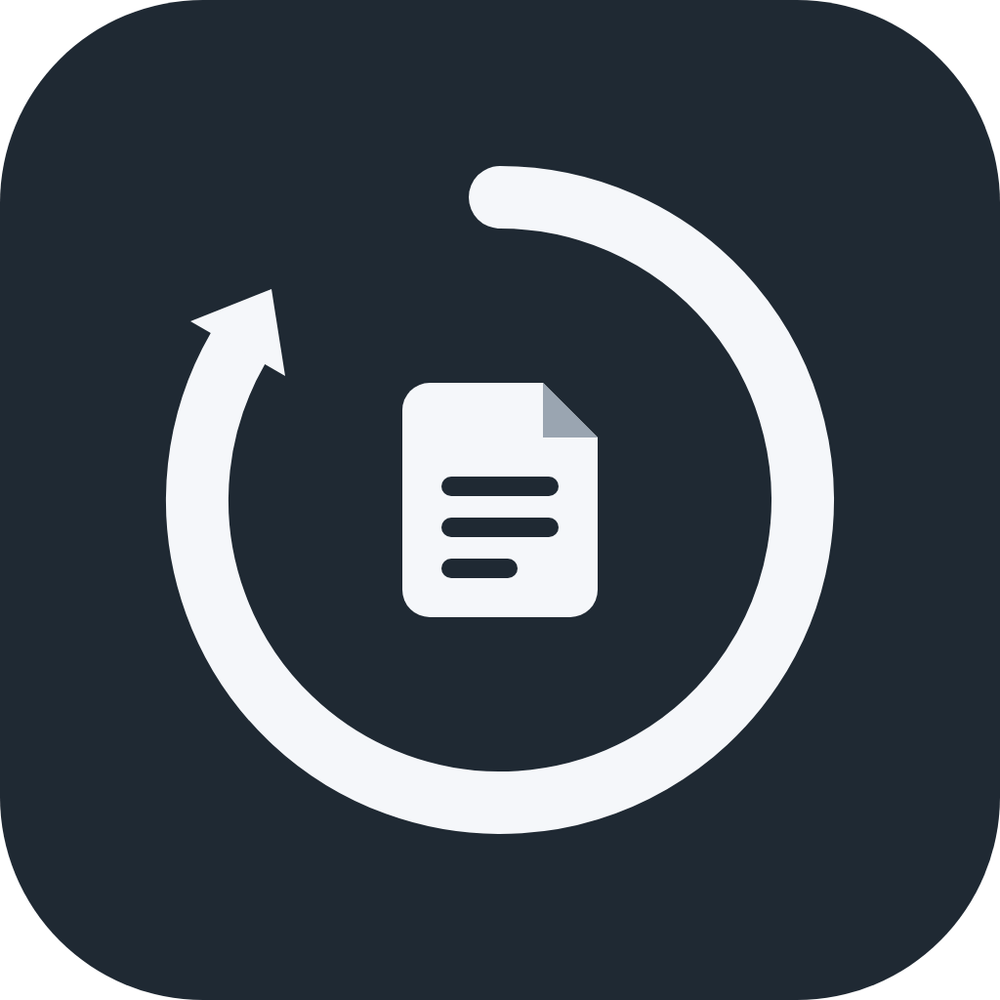
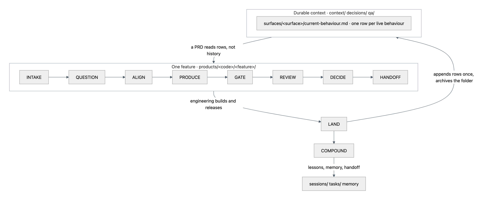
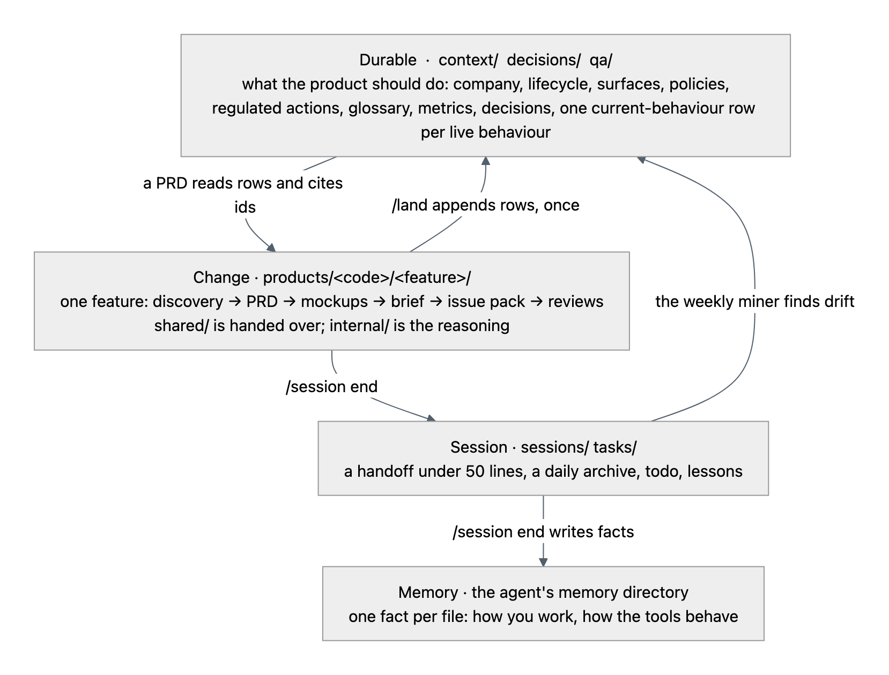
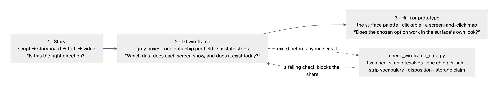

<p align="center">
  
</p>

<h1 align="center">Shipwright</h1>

<p align="center"><strong>Product work as a system, not a chat.</strong><br>
Skills, read-only reviewers and hooks on top of a durable context layer —<br>
and one fictional company run through a feature end to end, so you can see every step.</p>

<p align="center">
  <a href="LICENSE"></a>
  <a href="CHANGELOG.md"></a>
  <a href="#start-in-sixty-seconds"></a>
  <a href="docs/09-running-your-agent.md"></a>
  <a href="https://github.com/DvJ4Y/shipwright/stargazers"></a>
</p>

<p align="center">
  <a href="#start-in-sixty-seconds">Start</a> ·
  <a href="#look-first">Look first</a> ·
  <a href="#the-loop">The loop</a> ·
  <a href="#four-context-layers">Context layers</a> ·
  <a href="#the-visual-method">Visual method</a> ·
  <a href="docs/README.md">Docs</a> ·
  <a href="CONTRIBUTING.md">Contribute</a>
</p>


<p align="center"><sub>Five beats from the worked feature's story. Product vision, not shipped; every number is a demo number.
<a href="products/desk/verification-outcome-and-rework/showcase/story-script.md">The twelve-beat script</a> ·
<a href="products/desk/verification-outcome-and-rework/showcase/story-v1.mp4">the full video</a>.</sub></p>

## Who it is for

A product lead — a founder doing product alone, or a product team at a company up to
Series C — who already works with an agent and wants the work to accumulate instead of
starting from zero every chat. Claude Code first; Codex reads the same layout.

## Start in sixty seconds

```bash
git clone https://github.com/DvJ4Y/shipwright shipwright && cd shipwright
claude            # accept the trust dialog on the first run
/onboard          # your profile, the skills on the worked example, one real item
```

Then start any piece of work with `/product-loop`. It returns a verdict, a tier and the
skills to run. Or click **Use this template** above to start your own copy.

**Already have a project?** Install only the skills, reviewers and hooks:

```
/plugin marketplace add DvJ4Y/shipwright
/plugin install shipwright@shipwright
```

Clone or plugin, never both in one repo: the plugin inside a clone runs every hook twice.
[Running your agent](docs/09-running-your-agent.md) has the detail, including the Codex
behaviours not yet verified.

## Look first

Every artifact from one feature run through the loop, in the order the loop produced them.

| Step | Open |
|---|---|
| The company it runs on | [Harbor Cover](context/01-company.md) — a fictional small-business insurance distributor; every figure labelled `example` |
| What each surface does today | [Desk current behaviour](context/surfaces/desk/current-behaviour.md), one row per live behaviour |
| The feature, start here | [Verification outcome and rework](products/desk/verification-outcome-and-rework/README.md) |
| Discovery | [Business case and verdict](products/desk/verification-outcome-and-rework/internal/discovery.md) |
| Requirements | [PRD](products/desk/verification-outcome-and-rework/shared/prd.md) — WHAT and WHY, sixteen observable criteria |
| Review | [Six-lens gate report](products/desk/verification-outcome-and-rework/internal/review-2026-11-02-gate.md) |
| Wireframe | [Desk rework queue, L0](products/desk/verification-outcome-and-rework/mockups/desk-rework-queue-v1.mockup.html) — one data chip per field |
| Handoff | [Engineering brief](products/desk/verification-outcome-and-rework/shared/eng-brief.md) · [issue pack](products/desk/verification-outcome-and-rework/internal/issue-pack.md) |
| Land | [Land rehearsal](products/desk/verification-outcome-and-rework/internal/land-rehearsal.md) — what `/land` writes back when it ships |

## The loop



The loop ends at LAND, not at HANDOFF. When a feature ships, `/land` appends one row per
requirement to the surface's current-behaviour table and archives the feature folder. The
next PRD reads rows, not history. Every correction becomes a rule in `tasks/lessons.md`.
[The loop in full](docs/03-the-loop.md).

| You say | The harness does |
|---|---|
| "I want to work on…" | `/product-loop` — go, clarify or park; tier S, M or L; the workflow of skills |
| "Is this worth building?" | `/product-discovery` — labelled evidence, operational viability, a verdict |
| "Help me decide" | `/decide` — your leaning first, three rounds at most, a logged decision point |
| "Write the PRD" | `/prd-writer` — WHAT and WHY, observable acceptance, every state the screen can reach |
| "Mock this up" | `/mockup` — a story, a wireframe with a data chip on every field, hi-fi, prototype |
| "Write the copy" / "translate this" | `/product-copy`, `/localisation-copy` |
| "Review this" | `/review` — read-only lenses; Critical, Major, Minor, Outdated; one verdict |
| "Hand to engineering" | `/engineering-brief`, then `/issue-tracker` — pack, publish, read-back |
| "This shipped" | `/issue-tracker release`, `/review post-ship`, `/land` |
| "Pull the data" | `/data-analysis` — decision, boundary, source, label |

Underneath: always-on rules; three hooks that load your context at start, ask for a
handoff at stop and block edits to generated files; curated permissions; two MCP servers;
a weekly sync that checks the context against the week's sessions. Where judgement stays
human: every gate, every locked decision, talking to customers.

## Four context layers



Durable context is the source of truth; every artifact is regenerable from it. The product
lead reviews a small body of context and a short change, not every line of every document.
[What goes where](docs/02-context-layers.md) · [why it is built this way](docs/00-why.md).

## The visual method



Three steps, in order. Each answers a different question. None is a source of business
rules; the PRD is. The wireframe checker reads the feature's data packet and fails the
share when a chip points at nothing. [The rules](docs/04-visual-method.md).

## The layout at a glance

```
AGENTS.md  CLAUDE.md  _profile.md      the agent's instructions and your profile
.agents/skills/  .agents/hooks/        16 skills and 3 hooks — the source of truth
.claude/  .codex/                      wrappers: rules, reviewers, settings
context/                               the durable layer: company, lifecycle, surfaces, policies, glossary, metrics
products/<code>/<feature>/             one feature: shared/ (handed over) · internal/ (reasoning) · mockups/ · showcase/
decisions/  qa/  releases/             the decision log · test-case catalogs · release notes
sessions/  tasks/                      handoffs · todo · lessons
tools/  automations/  templates/       wireframe kit, story builder, query runner · the weekly sync · one template per artifact
docs/                                  the craft: twelve documents and the lessons
plugin/                                generated; do not hand-edit
```

[Who writes each folder](docs/01-folder-structure.md).

## Make it yours

[`scripts/substitutions.csv`](scripts/substitutions.csv) lists every name to swap: the
company, the surfaces, the stage names, the roles, the personas, the tracker key. Replace
the values, then rewrite `context/` from production with [`templates/`](templates/README.md)
and [`context/README.md`](context/README.md) as the guide. Fill `_profile.md`. Run
`bash scripts/check-pack.sh` until it reports nothing.

## What is deliberately not here

- No engineering specs, API contracts, schemas or estimates. Product writes WHAT and WHY;
  engineering writes HOW.
- No real company's data. Harbor Cover is fiction; the replica tables and the events are
  pretend.
- No language pack. `/localisation-copy` includes a template; you build the pack for your
  customers' language.
- No dashboards. A dashboard starts from a decision, not from a tool.
- No vendor lock. Skills name capabilities — the tracker, event analytics, the SQL replica,
  the BI tool — and only the adapters name vendors.

## Star it, try it, tell me what broke

Star it if you want product work to leave a durable trail instead of a chat log.

Run it on one real feature, then [open an issue](https://github.com/DvJ4Y/shipwright/issues/new/choose):
something broke, propose a change, or we ran the loop. Questions go to
[Discussions](https://github.com/DvJ4Y/shipwright/discussions). Pull requests take one
skill, rule or document each; [CONTRIBUTING](CONTRIBUTING.md) has the rest and the
[code of conduct](CODE_OF_CONDUCT.md) applies everywhere. [Privacy](PRIVACY.md): the pack
collects nothing.

## Licence

[MIT](LICENSE).
