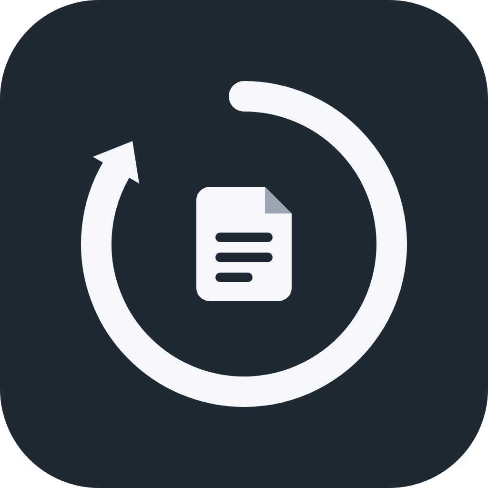
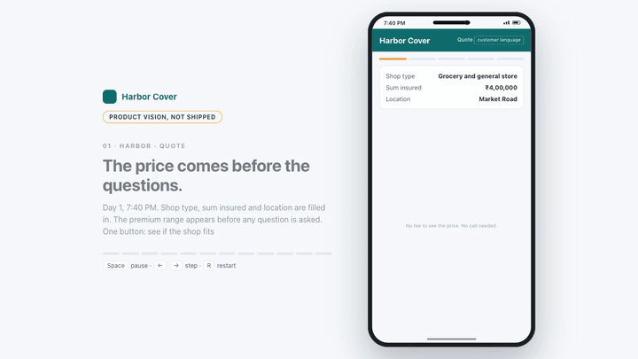
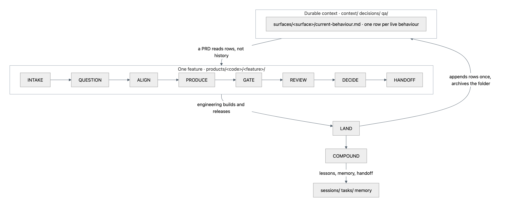
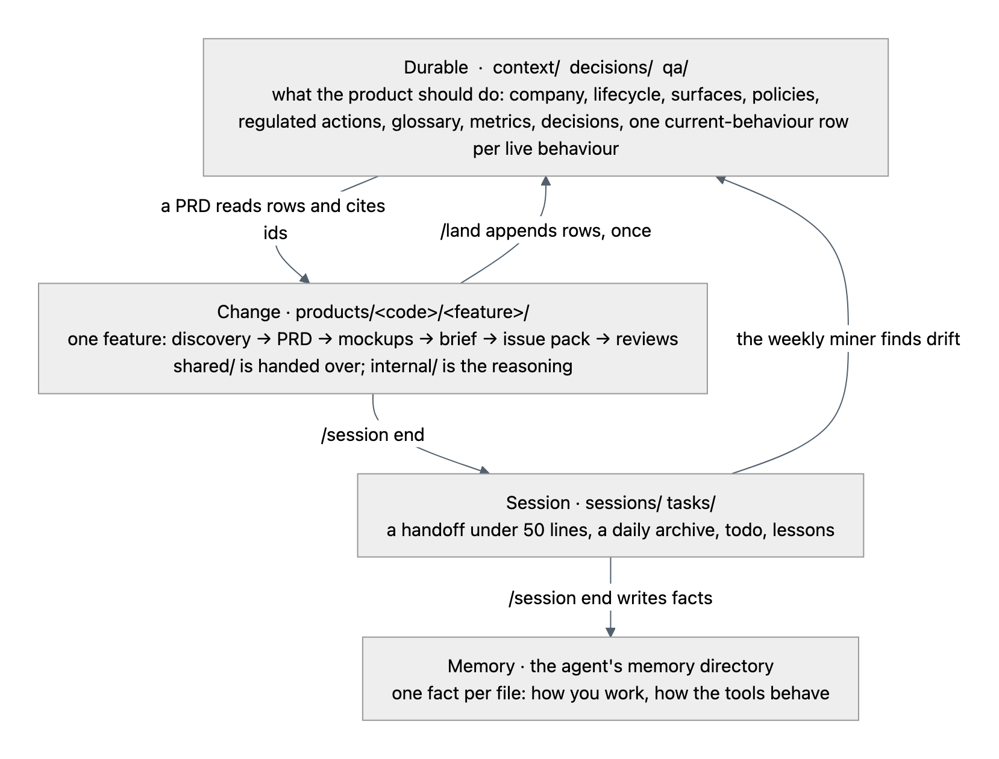
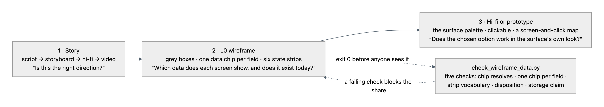

<p align="center">
  
</p>

<h1 align="center">Shipwright</h1>

<p align="center"><strong>A product brain for your coding agent that learns from your files and chats.</strong><br>
Drop in your notes, PRDs and call transcripts. Shipwright turns them into a profile and a<br>
ledger of sourced facts that Claude Code and Codex read before every piece of work —<br>
then runs that work through skills, read-only reviewers and gates.</p>

<p align="center">
  <a href="LICENSE"></a>
  <a href="CHANGELOG.md"></a>
  <a href="#install"></a>
  <a href="#install"></a>
  <a href="https://github.com/DvJ4Y/shipwright/stargazers"></a>
</p>

<p align="center">
  <a href="#start-in-three-commands">Start</a> ·
  <a href="#how-it-learns">How it learns</a> ·
  <a href="#what-makes-it-different">What is different</a> ·
  <a href="#install">Install</a> ·
  <a href="#look-first">The example</a> ·
  <a href="docs/README.md">Docs</a>
</p>

## Start in three commands

```bash
git clone https://github.com/DvJ4Y/shipwright my-product && cd my-product
claude            # accept the trust dialog on the first run
```

| Command | What it does |
|---|---|
| `/setup` | Builds your profile and the first facts from whatever you drop into `inbox/` — or from one pasted description, or a short interview. Safe to re-run |
| `/learn` | Reads new files, captured chats and URLs; proposes typed, sourced facts; surfaces contradictions and expired facts; writes only what you approve |
| `/product-loop` | Starts any piece of work: a verdict, a tier and the skills to run, all reading what Shipwright already knows |

Everything else — discovery, PRDs, mockups, reviews, engineering briefs, issue packs,
landing what shipped — runs behind these three. A fresh clone is empty: it becomes yours,
not a template you have to rewrite.

## How it learns

```
inbox/                anything you drop in: notes, PRDs, transcripts, exports, urls.md
inbox/sessions/       your chats, captured at the end of each session (never committed)
   │  /learn          typed facts with a source · contradictions surfaced · expiry · your approval
   ▼
knowledge/PROFILE.md  who you are, the product, how you work — injected at every session start
knowledge/facts.md    the ledger: decision · metric · target · behaviour · outcome · preference …
knowledge/lessons.md  your corrections, as rules
   ▲
   │  /land           what actually shipped, and what happened after
your work             every skill reads knowledge/ first and never asks for what it holds
```

Three hooks keep it running without effort: the session start injects your profile, each
prompt recalls the matching facts, and the session end captures the chat for the next
`/learn`. It is all plain markdown in your repository — no database, no account, no
background calls. [The learning layer in full](docs/12-the-learning-layer.md).

## What makes it different

| | Prompt libraries | General agent memory | Shipwright |
|---|---|---|---|
| Learns from your work | No — every run starts from zero | Yes, from chats | Yes, from files, chats, URLs and **what shipped** |
| Knows a target from a measured number | No | No | Yes — every figure carries a source label; a target is never a baseline |
| Handles change | — | Overwrites or appends | Supersedes with history; expires dated facts; asks on a contradiction |
| Where it lives | Prompts | A database or a hosted service | Markdown in your repo; Claude Code and Codex share it |
| Checks the work | No | No | Read-only reviewers, tiered gates, a pack check, a wireframe chip check |

## Install

| Route | Command | You get |
|---|---|---|
| Clone (recommended) | `git clone https://github.com/DvJ4Y/shipwright my-product` | Everything: skills, hooks, `knowledge/`, `inbox/`, tools, the worked example |
| Claude Code plugin | `/plugin marketplace add DvJ4Y/shipwright` then `/plugin install shipwright@shipwright` | Skills, reviewers and hooks inside a project you already have |
| Any agent (Claude Code, Codex, Cursor) | `npx skills add DvJ4Y/shipwright` | The skills only, in each agent's skills folder |

Clone or plugin, never both in one repo: the plugin inside a clone runs every hook twice.
Codex reads `AGENTS.md`, `.agents/skills/` and `.codex/hooks.json`; the hooks are wired and
not yet verified on Codex. [Running your agent](docs/09-running-your-agent.md).

## Look first

A fresh clone is an empty workspace for your product. The worked example lives in
`examples/harbor-cover/`: every artifact from one feature run through the loop, in order.



<sub>Six beats from the example's story. Product vision, not shipped; every number is a demo number. <a href="examples/harbor-cover/products/desk/verification-outcome-and-rework/showcase/story-v2.mp4">The full video</a>.</sub>

| Step | Open |
|---|---|
| The company it runs on | [Harbor Cover](examples/harbor-cover/README.md) — a fictional small-business insurance distributor in `examples/harbor-cover/`; every figure labelled `example` |
| What each surface does today | [Desk current behaviour](examples/harbor-cover/context/surfaces/desk/current-behaviour.md), one row per live behaviour |
| The feature, start here | [Verification outcome and rework](examples/harbor-cover/products/desk/verification-outcome-and-rework/README.md) |
| Discovery | [Business case and verdict](examples/harbor-cover/products/desk/verification-outcome-and-rework/internal/discovery.md) |
| Requirements | [PRD](examples/harbor-cover/products/desk/verification-outcome-and-rework/shared/prd.md) — WHAT and WHY, sixteen observable criteria |
| Review | [Six-lens gate report](examples/harbor-cover/products/desk/verification-outcome-and-rework/internal/review-2026-11-02-gate.md) |
| Wireframe | [Desk rework queue, L0](examples/harbor-cover/products/desk/verification-outcome-and-rework/mockups/desk-rework-queue-v2.mockup.html) — one data chip per field |
| Handoff | [Engineering brief](examples/harbor-cover/products/desk/verification-outcome-and-rework/shared/eng-brief.md) · [issue pack](examples/harbor-cover/products/desk/verification-outcome-and-rework/internal/issue-pack.md) |
| Land | [Land rehearsal](examples/harbor-cover/products/desk/verification-outcome-and-rework/internal/land-rehearsal.md) — what `/land` writes back when it ships |

## The loop



The loop ends at LAND, not at HANDOFF. When a feature ships, `/land` appends one row per
requirement to the surface's current-behaviour table and archives the feature folder. The
next PRD reads rows, not history. Every correction becomes a rule in `knowledge/lessons.md`.
[The loop in full](docs/03-the-loop.md).

| You say | The harness does |
|---|---|
| "I want to work on…" | `/product-loop` — go, clarify or park; tier S, M or L; the workflow of skills |
| "Is this worth building?" | `/product-discovery` — labelled evidence, operational viability, a verdict |
| "Help me decide" | `/decide` — your leaning first, three rounds at most, a logged decision point |
| "Write the PRD" | `/prd-writer` — WHAT and WHY, observable acceptance, every state the screen can reach |
| "Mock this up" | `/mockup` — a story, a wireframe with a data chip on every field, hi-fi, prototype |
| "Write the copy" / "translate this" | `/product-copy`, `/localisation-copy` |
| "Review this" | `/review` — read-only lenses; Critical, Major, Minor, Outdated; one verdict |
| "Hand to engineering" | `/engineering-brief`, then `/issue-tracker` — pack, publish, read-back |
| "This shipped" | `/issue-tracker release`, `/review post-ship`, `/land` |
| "Pull the data" | `/data-analysis` — decision, boundary, source, label |

Underneath: always-on rules; four hooks that load your context at start, recall facts on each prompt, capture the chat and ask for a
handoff at stop and block edits to generated files; curated permissions; two MCP servers;
a weekly sync that checks the context against the week's sessions. Where judgement stays
human: every gate, every locked decision, talking to customers.

## Four context layers



Durable context is the source of truth; every artifact is regenerable from it. The product
lead reviews a small body of context and a short change, not every line of every document.
[What goes where](docs/02-context-layers.md) · [why it is built this way](docs/00-why.md).

## The visual method



Three steps, in order. Each answers a different question. None is a source of business
rules; the PRD is. The wireframe checker reads the feature's data packet and fails the
share when a chip points at nothing. [The rules](docs/04-visual-method.md).

## The layout at a glance

```
AGENTS.md  CLAUDE.md                  the agent's instructions
knowledge/  inbox/                     your profile, fact ledger and lessons · material waiting for /learn
.agents/skills/  .agents/hooks/        18 skills and 4 hooks — the source of truth
.claude/  .codex/                      wrappers: rules, reviewers, settings
context/                               chapters a fact outgrows: lifecycle, surfaces, policies, glossary, metrics
products/<code>/<feature>/             one feature: shared/ (handed over) · internal/ (reasoning) · mockups/ · showcase/
decisions/  qa/  releases/             the decision log · test-case catalogs · release notes
sessions/  tasks/                      handoffs · todo
examples/harbor-cover/                 the fictional worked example, complete and openable
tools/  automations/  templates/       wireframe kit, story builder, query runner · the weekly sync · one template per artifact
docs/                                  the craft: thirteen documents and the lessons
plugin/                                generated; do not hand-edit
```

[Who writes each folder](docs/01-folder-structure.md).

## Make it yours

The root is already yours: `context/`, `products/`, `decisions/` and `qa/` start empty. Drop
your notes, PRDs and exports into `inbox/`, run `/setup`, then `/learn` whenever something
new arrives. Leave `examples/harbor-cover/` as a reference or delete it. Run
`bash scripts/check-pack.sh` until it reports nothing.

## What is deliberately not here

- No engineering specs, API contracts, schemas or estimates. Product writes WHAT and WHY;
  engineering writes HOW.
- No real company's data. Harbor Cover, in `examples/`, is fiction; its replica tables and
  events are pretend.
- No language pack. `/localisation-copy` includes a template; you build the pack for your
  customers' language.
- No dashboards. A dashboard starts from a decision, not from a tool.
- No vendor lock. Skills name capabilities — the tracker, event analytics, the SQL replica,
  the BI tool — and only the adapters name vendors.

## Star it, try it, tell me what broke

Star it if you want product work to leave a durable trail instead of a chat log.

Run it on one real feature, then [open an issue](https://github.com/DvJ4Y/shipwright/issues/new/choose):
something broke, propose a change, or we ran the loop. Questions go to
[Discussions](https://github.com/DvJ4Y/shipwright/discussions). Pull requests take one
skill, rule or document each; [CONTRIBUTING](CONTRIBUTING.md) has the rest and the
[code of conduct](CODE_OF_CONDUCT.md) applies everywhere. [Privacy](PRIVACY.md): the pack
collects nothing.

## Licence

[MIT](LICENSE).
